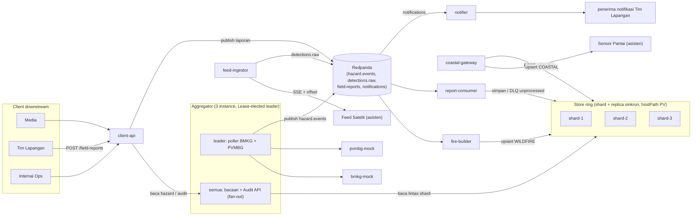

<!--
===========================================================================
CHECKLIST KELLENGKAPAN TERHADAP BAGIAN "LAPORAN" SPESIFIKASI M2
(Semua butir wajib ada di dokumen ini. Jangan hapus sebelum ekspor PDF.)

Bagian Umum:
- [x] Halaman sampul (placeholder IF4031_M2_SixtributedSystems)
- [x] Tabel kontribusi (placeholder)
- [x] Deskripsi umum sistem
- [x] Diagram arsitektur (mermaid)
- [x] Daftar teknologi terpilih
- [x] Asumsi
- [x] Petunjuk menjalankan sistem
- [x] Diagram deployment (penempatan komponen per node + jalur data antar-node)
- [x] Perubahan dari M1 (dipertahankan / diubah / dibatalkan + alasan)
- [x] Deklarasi topologi (placeholder, merujuk docs/topology.md)
- [x] Form Penggunaan AI (placeholder, wajib sama dengan M1)

Bagian Per Problem (untuk setiap P1-P5):
- [x] 1. Identifikasi masalah + nama persoalan dalam literatur
- [x] 2. Rancangan solusi dan mekanisme yang dipilih
- [x] 3. Alasan keputusan (alternatif + trade-off)
- [x] 4. Batasan yang disadari
- [x] 5. Bukti penyelesaian per kriteria (placeholder [BUKTI: ...])
- [x] 6. Jawaban atas seluruh butir "Di laporan" pada problem terkait

Lain-lain:
- [x] Ketentuan penulisan (bahasa, istilah teknis, gaya sama dengan M1)
- [x] Lampiran pointers (Audit API, Tabel Sumber Daya, Kontrak Sensor Pantai)
===========================================================================
-->

# Laporan Milestone 2 — Sistem Terdistribusi Skalabel

**IF4031 — Arsitektur Aplikasi Terdistribusi**
**Kelompok: SixtributedSystems**
**Berkas: IF4031_M2_SixtributedSystems.pdf**

---

## Bagian Umum

### Sampul

> [PLACEHOLDER SAMPUL: gunakan template sampul yang sama dengan M1 — logo institusi, judul "IF4031 — Tugas Besar Milestone 2: Sistem Terdistribusi Skalabel", nama kelompok **SixtributedSystems**, daftar anggota + NIM, tanggal 20 November 2026.]

### Tabel Kontribusi

> [PLACEHOLDER: isi tabel berikut sebelum pengumpulan.]

| Anggota | NIM | Kontribusi Utama | Bagian Laporan |
| --- | --- | --- | --- |
| (nama) | (NIM) | (misal: store service + vnode ring) | (bagian) |
| (nama) | (NIM) | (misal: Lease election + load testing) | (bagian) |
| (nama) | (NIM) | (misal: DLQ + field-reports) | (bagian) |
| (nama) | (NIM) | (misal: fire-builder + SSE) | (bagian) |
| (nama) | (NIM) | (misal: coastal-gateway + observabilitas) | (bagian) |
| (nama) | (NIM) | (misal: migrasi Kubernetes + Helm chart) | (bagian) |

### Deskripsi Umum Sistem

Sistem yang sama dengan Milestone 1 — platform koordinasi kebencanaan yang menjembatani BMKG, PVMBG, dan BNPB — kini berjalan di atas Kubernetes (k3s, dua node dengan kernel terpisah) dan menangani tiga sumber data baru: hotspot satelit, sensor pantai, dan laporan tulis dari Tim Lapangan.

Komponen yang dibawa dari M1 tanpa perubahan peran:

- **bmkg-mock** dan **pvmbg-mock**: simulasi instansi sumber, kontrak tidak berubah (ditambah endpoint admin sesuai ketentuan M2).
- **aggregator**: polling BMKG/PVMBG, pemetaan ke format kanonik **HazardEvent**, penyediaan Audit API. Di M2 berjalan ≥3 instance; hanya instance pemegang Lease yang melakukan polling (lihat P2), semua instance melayani bacaan dan Audit API dengan fan-out ke seluruh unit penyimpanan.
- **auth-service**: penerbitan JWT per client (Media, Tim Lapangan, Internal Ops) dengan scope dan model hak akses M1.
- **client-api**: titik masuk tunggal downstream, validasi JWT, proyeksi field Ringkasan/Mentah.
- **consumer dashboard** dan **notifier**: consumer independen pada stream event bahaya.

Komponen baru di M2:

- **store service** (multi-instance, `role=store`): penyimpanan kanonik terpecah (sharded). Setiap instance memiliki PostgreSQL sendiri di atas **hostPath PV** pada node tempat pod berjalan, sesuai ketentuan data `role=store` wajib lokal node. Data dirutekan dengan **consistent hashing berbasis virtual node (vnode ring)** dan disalin ke **replica sinkron** pada node lain (lihat P1).
- **feed-ingestor**: konsumsi aliran **Server-Sent Events (SSE)** dari Feed Satelit asisten, persistensi offset koneksi, publikasi deteksi mentah ke topik Kafka `detections.raw` (lihat P4).
- **fire-builder**: stream processor yang menggabungkan deteksi menjadi kebakaran (**WILDFIRE**) sesuai Definisi Kebakaran (union-find, rantai ≤ 1 km dan ≤ 360 menit), lalu menulis HazardEvent ke store (lihat P4).
- **coastal-gateway**: klien tunggal untuk **Sensor Pantai**, validasi kontrak dasar, circuit breaker, dan penulisan **COASTAL** ke store (lihat P5).
- **report-consumer**: consumer topik `field-reports`; menyimpan laporan Tim Lapangan, dengan tabel **unprocessed** (DLQ berbasis PostgreSQL) untuk pesan yang gagal diproses (lihat P3).
- **Redpanda**: message broker (protokol Kafka) menggantikan RabbitMQ dari M1.
- **kube-prometheus-stack + Loki + Tempo**: stack observabilitas — metrik dalam satu dashboard, distributed tracing, dan log terstruktur ber-correlation ID untuk seluruh service.

### Diagram Arsitektur

Jalur tulis: satelit (feed-ingestor → `detections.raw` → fire-builder → store), sensor pantai (coastal-gateway → store), laporan lapangan (client-api → `field-reports` → report-consumer → store), sumber instansi (aggregator leader → store). Jalur baca: client-api → aggregator (fan-out lintas shard). Jalur notifikasi: aggregator → `hazard.events`/`notifications` → notifier.

### Daftar Teknologi

| Teknologi | Peran |
| --- | --- |
| Go | Bahasa implementasi seluruh service |
| pgx | Driver PostgreSQL pada store service, aggregator, auth-service, report-consumer |
| kafka-go + Redpanda | Message broker protokol Kafka (ganti RabbitMQ), topik `hazard.events`, `detections.raw`, `field-reports`, `notifications` |
| client-go | Watch membership node/pod store dan pengelolaan Lease K8s (P1, P2) |
| OpenTelemetry | Instrumentasi tracing dan metrik lintas service |
| k3s | Distribusi Kubernetes, 2 node VM |
| Helm | Chart `infra/helm/sixtributed` untuk deploy seluruh komponen |
| k6 | Load testing (P2, P5) |
| PostgreSQL | Penyimpanan per unit store (JSONB `attributes`, tanpa migrasi skema) |
| kube-prometheus-stack, Loki, Tempo | Metrik (Grafana), log terstruktur, distributed tracing |
| Docker | Kemasan image per service |

### Asumsi

1. Node worker non-control-plane (node-b) adalah sasaran skenario pemadaman node; sesuai ketentuan, skenario mematikan node hanya dikenakan pada worker non-control-plane.
2. Token Feed Satelit (group-token), audit-token asisten, dan `PANTAI_AUTH_TOKEN` disimpan sebagai Secret dan diisi sebelum demo; `values-prod.yaml` berisi placeholder.
3. Dataset katalog gempa historis untuk kriteria 1 P1 diberikan asisten; sistem memuatnya melalui jalur ingest yang sama dengan data lain (tidak ada tulis langsung ke store).
4. Waktu acuan seluruh pipeline adalah waktu dari sumber data (event time: `acq_date`+`acq_time`, `observed_at`, `occurred_at`); waktu lokal node hanya untuk `ingested_at`.
5. Tester Agent dipasang tanpa modifikasi image dan tanpa pembatasan apa pun; seluruh pod aplikasi berada di namespace `sistem-informasi-kebencanaan-bnpb` dengan label `role` sesuai daftar ketentuan.
6. Dashboard analitik (kriteria 7 P1) dibangun di atas data yang sama dengan Audit API, bukan salinan terpisah.

### Petunjuk Menjalankan Sistem

Seluruh langkah terdokumentasi di [README.md](../README.md). Ringkas:

1. Build dan muat image ke kedua node: `./scripts/build-and-load-images.sh`.
2. Bootstrap cluster (k3s server di node-a, agent di node-b) dan deploy chart: `./scripts/bootstrap-cluster.sh`.
3. Isi Secret pada `infra/helm/values-prod.yaml` sebelum demo.
4. Verifikasi: `kubectl get pods -n sistem-informasi-kebencanaan-bnpb`.
5. Pemicu setiap skenario pengujian (outage PVMBG, skema, DLQ replay, skenario Tester Agent `run practice`) tercantum di README.

### Diagram Deployment

Dua node VM dengan kernel terpisah. Node-a adalah k3s **server sekaligus worker** (control plane), node-b **worker**. Komponen stateless disebar ke kedua node dengan pod anti-affinity per hostname; komponen stateful ditempatkan eksplisit agar kehilangan satu node tetap menyisakan data.

```mermaid
flowchart TB
  subgraph NA["node-a (k3s server + worker, control plane)"]
    direction TB
    RP["Redpanda (role=broker)"]
    SA1["store shard-1 primary (hostPath PV)"]
    SB1["store shard-2 replica (hostPath PV)"]
    AG1["aggregator x1..2"]
    API1["client-api, auth-service"]
    ING1["feed-ingestor"]
    FB1["fire-builder"]
    CG1["coastal-gateway"]
    RC1["report-consumer"]
    DASH["kube-prometheus-stack + Loki + Tempo + dashboard analitik"]
    MOCK1["bmkg-mock, pvmbg-mock"]
  end

  subgraph NB["node-b (worker)"]
    direction TB
    SA2["store shard-1 replica (hostPath PV)"]
    SB2["store shard-2 primary (hostPath PV)"]
    SA3["store shard-3 primary (hostPath PV)"]
    AG2["aggregator x1..2"]
    API2["client-api, auth-service"]
    ING2["feed-ingestor"]
    FB2["fire-builder"]
    CG2["coastal-gateway"]
    RC2["report-consumer"]
    NOT1["notifier, dashboard consumer"]
    SP1["Sensor Pantai (image asisten)"]
  end

  RP <--> AG1
  RP <--> ING1
  RP <--> RC1
  SA1 <-. "rep sinkron" .-> SA2
  SB1 <-. "rep sinkron" .-> SB2
```

Penempatan dalam kata-kata:

- **node-a**: Redpanda, kube-prometheus-stack/Loki/Tempo, dashboard analitik, kedua mock, serta satu–dua replica dari setiap service stateless.
- **node-b**: Sensor Pantai, sisa replica stateless, dan mayoritas primary shard store.
- **Store**: setiap shard punya satu primary dan satu replica sinkron yang **selalu di node berbeda**; sehingga kehilangan node-b (skenario worker) hanya menghilangkan sebagian primary, dan replica di node-a langsung dipromosikan (P1 kriteria 4, 6).
- Jalur data antar-node: replikasi sinkron antar-shard, konsumsi Kafka, fan-out bacaan Audit API, dan gossip ring membership melalui watch API K8s.

### Perubahan dari M1

| Keputusan M1 | Status di M2 | Alasan |
| --- | --- | --- |
| Correlation middleware dan log terstruktur JSON | **Dipertahankan** | Masih menjadi basis ketentuan Observabilitas M2; kini diteruskan pula ke header Kafka message dan dilihat di Tempo/Loki. |
| JWT auth, scope, model hak akses tiga client (Media/Tim Lapangan/Internal Ops) | **Dipertahankan** | Kontrak client tidak berubah; Tim Lapangan mendapat hak tulis baru (`POST /field-reports`) pada scope yang sama. |
| Pemetaan kanonik + upsert `source_ref_id` (field dinamis ke `attributes` JSONB, tanpa migrasi) | **Dipertahankan** | Sudah benar untuk perubahan skema aditif; diperluas ke WILDFIRE dan COASTAL sesuai Aturan Pemetaan Tambahan. |
| Message broker RabbitMQ | **Diubah** → Kafka (Redpanda) | Kebutuhan M2: replay dari offset, partisi per kunci, retensi untuk keterlambatan panjang, dan consumer group — RabbitMQ tidak menyediakan offset yang dapat dilanjutkan maupun replay terkontrol. |
| Aggregator single-instance | **Diubah** → ≥3 instance di belakang satu entry point; hanya pemegang **K8s Lease** yang melakukan polling; Audit API melayani fan-out lintas shard | Kriteria P2 (single ingestion, failover ≤ 60 s) tidak mungkin dipenuhi satu instance; API baca tetap horizontal. |
| Canonical Store satu PostgreSQL milik Aggregator | **Diubah** → kumpulan **store service** ter-shard (vnode ring, replica sinkron, hostPath PV) | Kriteria P1: tidak ada satu node pun menyimpan seluruh data, dan ketentuan M2 menegaskan data `role=store` wajib di disk node tempat pod berjalan. |
| Pola polling M1 untuk sumber instansi | **Dipertahankan** untuk BMKG/PVMBG (kontrak mock pasif), **ditinggalkan** untuk Feed Satelit (push SSE, lihat P4) dan Sensor Pantai (polling tetap, dengan breaker, lihat P5). | Mengikuti behavior tiap sumber. |
| Komponen yang dibatalkan | **Tidak ada** | Seluruh keputusan M1 dibawa dan diuji ulang. |

### Deklarasi Topologi

Merujuk [docs/topology.md](topology.md). Placeholder yang wajib diisi sebelum demo:

> [PLACEHOLDER TOPOLOGI: node-a (VM, k3s server) berjalan pada HOST_A — isi host fisik, CPU, RAM, IP; node-b (VM, k3s agent) berjalan pada HOST_B — isi host fisik, CPU, RAM, IP. Jika kedua VM berjalan pada satu host fisik yang sama, nyatakan eksplisit. Nilai awal terdokumentasi di docs/topology.md.]

### Form Penggunaan AI

> [PLACEHOLDER: salin Form Penggunaan AI dari laporan M1 — tabel per anggota: alat AI yang dipakai, bagian kode/laporan yang dibantu, dan pernyataan verifikasi bahwa hasilnya dipahami dan diuji sendiri.]

---

## Problem 1 — Yang Pulang Membawa Laptopnya (Partisi dan Penyimpanan Terdistribusi)

### 1. Identifikasi Masalah

Empat persoalan murni sistem terdistribusi muncul bersamaan:

1. **Data partitioning / sharding** — satu penyimpanan tidak sanggup menampung tiga jenis bencana sekaligus; data harus dipecah ke beberapa mesin tanpa ada node yang menyimpan seluruh data (kriteria 1).
2. **Skew dan hot spot** — dataset gempa historis tidak tersebar merata; hampir semua gempa berada di jalur yang sama. Ini adalah masalah klasik *load skew* pada data partitioning: kunci alami (wilayah) berkorelasi dengan beban, sehingga partisi berdasar atribut domain menghasilkan hot spot (Kleppmann, *Designing Data-Intensive Applications*, bab 6).
3. **Rebalancing** — node datang dan pergi tanpa pematian sistem ("laptop baru esoknya"). Setiap perubahan membership harus memindahkan data seminimal mungkin dan tanpa menghentikan tulisan/bacaan.
4. **Partial failure semantics** — node hilang bersama datanya. Tanpa penanganan eksplisit, bacaan menjadi gagal total (500) atau diam-diam tidak lengkap. Konsepnya: **replication** (data yang hanya punya satu rumah ikut hilang bersama rumahnya), **read repair / replica promotion**, dan **degraded-but-honest responses** (`partial: true`, `unavailable_units`).

### 2. Rancangan Solusi

- **Store service ter-shard.** Penyimpanan kanonik pecah menjadi N unit (`shard-1..N`), masing-masing satu pod `role=store` dengan PostgreSQL sendiri di atas **hostPath PV** pada node tempat pod berjalan. Tidak ada komponen lain yang boleh terhubung langsung ke DB unit store (ketentuan M1 poin 2 tetap ditegakkan oleh platform: kredensial DB per unit hanya dimiliki pod store itu).
- **Rute tulis: consistent hashing dengan virtual node.** Kunci partisi adalah `source_ref_id` (stabil per sumber, dan untuk kebakaran deterministik). Setiap unit store mendeklarasikan beberapa **virtual node** pada ring hash 0..2^32. `hash(source_ref_id) → vnode → unit store pemilik`. Virtual node membuat distribusi vnode di antara unit fisik cukup acak sehingga beban tulis merata meski jumlah unit kecil.
- **Replica sinkron.** Setiap key juga ditulis ke **replica** milik successor vnode pada ring — dan desain penempatan menjamin primary dan replica berada di **node K8s berbeda**. Tulis dianggap berhasil bila primary dan replica keduanya commit (R=2 dari 2), sehingga mati satu node tidak menghilangkan data yang sudah di-ack.
- **Membership via K8s watch.** Setiap aggregator/client-api menjaga ring secara lokal dengan **watch** pada pod/Endpoint berlabel `role=store` melalui client-go. Pod store baru muncul → ring bertambah → vnode-nya ikut menerima key berikutnya dan menyerap data miliknya melalui **migrasi lazy** (data lama diambil dari primary lama saat pertama kali dibaca/tulis ulang) tanpa menghentikan lalu lintas. Pod store hilang → vnode-nya dikeluarkan dari ring; kalau yang hilang primary, **replica di unit lain dipromosikan** menjadi primary dan unit lain mengambil alih vnode yang kosong.
- **Baca lintas lokasi.** Endpoint "N event terbaru seluruh jenis bahaya" dan Audit API melakukan **scatter-gather**: query terkursor ke setiap unit store yang terjangkau, hasil di-merge dengan urutan (`ingested_at`, `hazard_id`) yang konsisten. Bila ada unit tidak terjangkau, jawaban tetap 200 dengan `partial: true` dan daftar `unavailable_units` — bukan 500, bukan menggantung (kontrak Lampiran A).
- **Read repair.** Saat baca menjangkau primary dan replica, versi yang lebih baru (bandingkan `ingested_at` + versi upsert) disalin ke yang tertinggal, sehingga perbedaan akibat tulisan semasa node turun menyembuhkan diri oleh lalu lintas baca.
- **Dashboard analitik.** Menghitung agregasi (per jenis bahaya, severity, area_name, time series) dari scatter-gather yang sama; saat ada unit tidak terjangkau, dashboard menampilkan badge "belum lengkap: <unit>" dan tetap merender, sesuai kriteria 7.

### 3. Alasan Keputusan (Alternatif dan Trade-off)

| Alternatif | Konsekuensi terhadap sebaran data (kriteria 2) | Keputusan |
| --- | --- | --- |
| **Consistent hashing + virtual node** (dipilih) | Sebaran kunci merata karena kunci di-hash, bukan dipetakan dari wilayah; hot spot alami dataset (jalur gempa yang sama) **hilang di level hash** — beban per node diukur saat load dan saat lonjakan wilayah tunggal. Node masuk/keluar hanya memindahkan ~K/N rentang ring (K = jumlah vnode). | Dipilih: memenuhi kriteria 1, 2, dan 5 sekaligus. |
| **Range partitioning per wilayah/waktu** | Sebaran mengikuti sebaran alami data → node pemegang rentang "jalur gempa utama" menjadi **hot spot** persis pada kriteria 2; range yang dipilih jelek sulit diperbaiki tanpa re-partisi penuh. | Ditolak: memperparah skew yang justru diukur. |
| **Hash modulo jumlah node** | Sebaran merata seperti consistent hashing, tetapi menambah/menghapus satu node memindahkan **hampir seluruh kunci** (mod berubah) → rebalancing besar-besaran, melanggar kriteria 5 (tanpa menghentikan tulisan). | Ditolak: biaya rebalancing tidak terkontrol. |

Untuk replikasi: **replica sinkron** (commit 2/2) dipilih di atas replica asinkron karena kriteria 4 menuntut **nol HazardEvent hilang** setelah node dihapus — asinkron berarti jendela kehilangan; sinkron berarti latensi tulis naik sedikit, yang dapat diterima pada laju data ini.

### 4. Batasan yang Disadari

- **Tidak ada vnode splitting untuk skew ekstrem.** Bila lonjakan wilayah tetap menghasilkan skew setelah hashing (misal volume tulis per key jauh lebih besar), sistem hanya meratakan jumlah kunci, bukan beban per key. Kriteria 2 dijawab dengan ukuran, bukan dengan mekanisme adaptif.
- **Migrasi lazy, bukan rebalancing penuh.** Data yang tidak pernah dibaca/ditulis ulang setelah node baru masuk tidak otomatis terdistribusi ulang; pemilik lama tetap menyimpannya sampai dibaca.
- **Tidak ada disaster recovery lintas wilayah/cluster.** Dua node dalam satu cluster: dua kegagalan node berturut-turut sebelum promosi selesai tetap berisiko.
- **Buffer hanya topik Kafka dengan retensi default.** Selama unit store turun, data tidak mengantre di store; kembali diproses dari sumber (lihat P3/P4) selama retensi broker mencukupi.
- Sebagian kecil jendela saat promosi replica: bacaan ke shard yang primary-nya hilang menjawab `partial: true` sesaat sebelum promosi selesai, sesuai semantik yang dinyatakan.

### 5. Bukti Penyelesaian

| Kriteria | Bukti |
| --- | --- |
| 1. Muat dataset, tidak ada node berisi seluruh data, sebaran dilaporkan | [BUKTI: tangkapan layar jumlah record per unit store (kubectl exec psql per shard) setelah memuat dataset katalog gempa + tabel sebaran per node] |
| 2. Ketidakmerataan alami | [BUKTI: grafik beban (CPU/write throughput) per node saat load dataset dan saat simulasi lonjakan gempa satu wilayah] |
| 3. Baca lintas lokasi dengan pagination benar | [BUKTI: curl GET "50 event terbaru" dua halaman berurutan + next_cursor, urutan sesuai (ingested_at, hazard_id)] |
| 4. Node dimatikan + data dihapus, checksum Audit API cocok, jawaban partial bukan 500 | [BUKTI: log Tester Agent node kill + GET /internal/audit/checksum sebelum/sesudah pulih (checksum identik) + tangkapan respons partial:true dengan unavailable_units selama pemulihan] |
| 5. Node baru ikut menanggung tanpa henti | [BUKTI: tangkapan sebaran sebelum/sesudah node baru masuk + k6 singkat berjalan tanpa error selama join] |
| 6. Kembali siap kehilangan satu node berikutnya | [BUKTI: checksum Audit API setelah penghapusan node kedua berturut-turut] |
| 7. Dashboard analitik dengan partial marker | [BUKTI: tangkapan dashboard analitik (line chart per jenis bahaya, severity, area_name) dan badge "belum lengkap" saat satu shard dimatikan; angka cocok dengan Audit API] |

### 6. Jawaban Butir "Di Laporan"

**1. Identifikasi persoalan dan konsep dalam literatur.** Persoalan intinya adalah membagi satu himpunan data yang tumbuh ke beberapa mesin (data partitioning/sharding), menjaga sebaran beban tetap merata ketika data alami tidak merata (skew dan hot spot), mengatur ulang pembagian ketika jumlah mesin berubah (rebalancing), dan tetap menjawab dengan benar saat sebagian mesin hilang (partial failure, replication, read repair, replica promotion). Semua kegagalan ini terjadi tanpa diumumkan dan bersamaan — sifat dasar sistem terdistribusi yang dipelajari di literatur (Kleppmann, DDIA bab 6; Tan & van Steen, distributed systems bab replikasi dan partisi).

**2. Mekanisme yang dipilih.** Lokasi sebuah data ditentukan murni oleh fungsi: `unit = ring_lookup(sha256(source_ref_id))`, dengan ring berisi vnode yang dimiliki unit-unit store. Karena kunci di-hash, data tidak pernah "bermukim" berdasarkan wilayah atau waktu, sehingga dataset gempa yang berat di jalur tertentu tetap terbagi merata. Keputusan berubah ketika node datang dan pergi melalui **watch K8s**: daftar unit store adalah sumber kebenaran platform, setiap proses yang memegang ring memperbarui tanggapan watch-nya dalam orde detik. Node keluar → vnode-nya diambil alih successor dan replica dipromosikan; node masuk → menerima vnode baru dan menangani tulisan baru seketika, sementara data lama berpindah secara lazy. Tulisan selama perubahan ring tetap sukses karena penanganan dobel: selama masa transisi, tulis dikirim ke pemilik lama dan baru (handoff), di-upsert idempoten.

**3. Perbandingan alternatif dan konsekuensinya untuk kriteria 2.** Tiga kandidat dibandingkan pada tabel bagian 3. Untuk kriteria 2 secara khusus: range partitioning akan menyalin skew dataset langsung ke beban node (hot spot pada jalur gempa utama — persis keluhan naratif problem); hash-mod merata tapi memindahkan hampir seluruh data saat resize; consistent hashing dengan vnode meratakan sebaran kunci sekaligus menjaga biaya rebalancing kecil. Konsekuensi yang diterima: hashing membuat kueri rentang waktu/wilayah harus scatter-gather, dan skew beban per-key ekstrem tetap tidak teratasi (lihat Batasan).

**4. Jaminan konsistensi per endpoint.**
- *Tulis (aggregator/fire-builder/coastal-gateway/report-consumer → store)*: at-least-once dari producer, di-upsert idempoten di store berdasarkan `source_ref_id`; commit menunggu primary + replica sinkron (R=2/2). Normal: read-your-writes untuk tulisan yang sudah di-ack. Node hilang: tulisan ke unit yang turun di-retry producer; laporan pengguna tetap dilayani lewat jalur P3 (202 + DLQ/retry) sehingga tidak hilang.
- *Baca tunggal (GET hazard by id)*: normal — dibaca dari primary; saat primary turun — dibaca dari replica yang sudah di-promosikan; di antara keduanya, baca menjawab dari unit terjangkau atau `partial`, tidak pernah 500.
- *Baca lintas unit (list terbaru, Audit API, dashboard)*: normal — urutan global konsisten dengan merge `(ingested_at, hazard_id)`; node hilang — jawaban 200 dengan `partial: true` + `unavailable_units`. Alasannya: kita mengutamakan **availability dengan honesty** (AP dengan penanda), karena kontrak Audit API secara eksplisit menolak error 500 dan menuntut penanda ketidaklengkapan; angka yang tampil tanpa penanda dianggap kebohongan yang lebih berbahaya daripada angka yang jujur sebagian.
- *Checksum*: dihitung dari semua unit terjangkau; saat partial, checksum disertai `partial: true` sehingga perbandingan dengan asisten dilakukan setelah sistem pulih.

**5. Agregasi dashboard dan penandaan ketidaklengkapan.** Dashboard tidak memiliki database sendiri. Setiap kueri agregasi dieksekusi sebagai scatter-gather: aggregator (atau endpoint analytics) mengirim agregasi per-unit (`GROUP BY` jenis bahaya/severity/area, dan bucket waktu) ke setiap unit store yang terjangkau, lalu menjumlahkan hasilnya. Karena agregasi per unit dijumlahkan (bukan dirata-rata), hasil identik dengan penghitungan langsung dari Audit API pada unit yang sama. Bila satu unit tidak terjangkau, jumlahan itu tetap ditampilkan tetapi diberi penanda eksplisit — badge "data belum lengkap" beserta daftar `unavailable_units` — dan endpoint agregasi menurunkan flag `partial` yang dibaca dashboard. Dashboard tidak pernah menampilkan angka parsial tanpa penanda.

---

## Problem 2 — Dua Nakhoda, Satu Kapal (Leader Election dan Fencing)

### 1. Identifikasi Masalah

Tiga kriteria memetakan ke tiga persoalan literatur:

1. **Kriteria 2 (tiga instance sama-sama bertanya → data triple)**: persoalan **single active writer / mutual exclusion**. Solusi naif "hanya satu yang boleh bertanya" tanpa koordinasi jatuh ke **split-brain**: dua instance sama-sama percaya dirinya pemimpin. Konsepnya: **leader election** dan **idempotent consumer** sebagai pengaman lapis kedua.
2. **Kriteria 4 (jam node bergeser ±30–45 detik)**: persoalan **sumber kebenaran waktu**. Keputusan berbasis jam lokal node (misal "saya pemimpin karena saya mencatat timestamp terbesar") rusak oleh **clock skew** — jam bukan sumber urutan yang dapat dipercaya antar-mesin. Konsepnya: waktu yang disepakati lewat satu layanan (monotonic per objek di API server), bukan timestamp lokal.
3. **Kriteria 5 (node freeze lama lalu bangun)**: persoalan **stale leader / fencing**. Pemimpin yang beku tidak tahu ia sudah digantikan; setelah bangun ia harus **tidak dapat menyimpan apa pun** sampai statusnya diperbarui. Konsepnya: **fencing token** dan lease expiry yang dinilai oleh pihak ketiga, bukan oleh pemegangnya sendiri.

### 2. Rancangan Solusi

- **Lease Kubernetes.** Ketiga instance aggregator bersaing memegang objek **Lease** (`coordination.k8s.io`) di namespace aplikasi, dengan `holderIdentity`, `leaseDurationSeconds: 15`, dan `renewDeadline`/`retryPeriod: 5` (pola `leaderelection` client-go). Hanya pemegang Lease yang menjalankan poller BMKG/PVMBG dan mempublikasi ke `hazard.events`; ketiga instance tetap melayani bacaan dan Audit API.
- **Sumber kebenaran waktu: API server.** `renewTime` dan `leaseTransitions` ditulis oleh API server dan dinilai terhadap **jam etcd/API server**, bukan jam node. Instance menilai "apakah Lease kedaluwarsa" dengan membaca objeknya — tidak ada instance yang mengambil keputusan dari jam lokalnya sendiri.
- **Fencing sebelum efek samping.** Sebelum setiap siklus polling dan sebelum setiap penulisan efek samping (publish ke Kafka, tulis ke store), pemegang **membaca ulang Lease dan membandingkan `holderIdentity`**. Bila bukan lagi pemegang — misalnya setelah bangun dari freeze — instance langsung menjadi follower tanpa menyimpan apa pun. Ini fencing token dalam bentuk identitas holder + `leaseTransitions` yang naik setiap pergantian.
- **Idempotensi lapis kedua.** Karena at-least-once tidak bisa dihilangkan sepenuhnya pada jendela transisi (leader lama publish, mati sebelum renew, leader baru mengambil periode yang sama), semua penulisan HazardEvent tetap **upsert pada `source_ref_id`** — dua nakhoda yang sesekali sama-sama menanyakan sumber yang sama menghasilkan satu baris, bukan tiga. Upstream juga terlindungi: kemungkinan terkecil permintaan berlipat terlihat di log upstream sebagai upsert yang identik, dan kriteria 2 diverifikasi lewat Audit API checksum (jumlah tidak berlipat).
- **Titik masuk sehat.** Ketiga instance berada di belakang satu Service; readiness probe hanya menganggap instance siap bila health-nya baik, sehingga instance yang beku/tidak sehat berhenti menerima permintaan baca.

### 3. Alasan Keputusan (Alternatif dan Trade-off)

| Alternatif | Evaluasi | Keputusan |
| --- | --- | --- |
| **K8s Lease + client-go leaderelection** (dipilih) | Waktu dinilai di API server/etcd → kebal clock skew node; objek Lease sudah HA bersama control plane; tidak ada komponen baru; `leaseTransitions` memberi fencing gratis. Trade-off: bergantung pada ketersediaan control plane, dan jendela kepemimpinan ganda kecil tetap mungkin pada flap jaringan → ditambal dengan fencing read-back + upsert idempoten. | Dipilih. |
| **PostgreSQL advisory lock** | Sederhana, tapi mengikat "siapa pemimpin" pada satu DB store — DB itu mati saat node hilang, election ikut mati (tersangkut pada P1); lock tanpa heartbeat yang baik tidak memberi fencing token yang aman terhadap klien yang beku lalu bangun. | Ditolak. |
| **Etcd eksternal / ZooKeeper** | Solusi tekstbook untuk election + fencing token eksplisit, tapi menambah sistem terdistribusi baru yang harus dioperasikan di 2 node — biaya operasional jauh melebihi manfaat karena K8s Lease memberi semantik yang sama di atas infrastruktur yang sudah ada. | Ditolak. |

**Batas waktu dan trade-off.** `leaseDurationSeconds: 15` dan `retryPeriod: 5`: follower menilai pemimpin mati paling lambat ~15 detik setelah renew terakhir gagal dan memilih pengganti; failover penuh (deteksi + kandidat naik) terjadi dalam ≤ 60 detik, memenuhi kriteria 3. Nilai lebih kecil (misal 5 detik) mempercepat failover tetapi rentan **flapping**: jitter jaringan sesaat bisa memicu pergantian pemimpin berulang, dan pemimpin lama yang sebenarnya hidup sering kehilangan hak; nilai lebih besar (misal 60 detik) melampaui target kriteria 3 dan memperpanjang jendela tanpa pemimpin. 15/5 adalah kompromi yang dipakai pola yang sama oleh komponen K8s sendiri.

### 4. Batasan yang Disadari

- **Jendela kepemimpinan ganda milidetik**: leader lama yang berjalan normal tetapi terpisah jaringan dari API server dapat menganggap dirinya masih pemimpin selama tidak berhasil membaca ulang Lease. Fencing read-back menutup efek samping pada jalur utama, tetapi periode polling yang sama bisa ditanya dua kali; konsistensi akhir dijamin upsert, bukan oleh election itu sendiri.
- **Failover ≤ 60 s berarti ada jendela tanpa polling hingga ~15–20 s**: data sumber instansi tertunda sesaat, tidak hilang (cursor `since` menyimpan posisi).
- **Bergantung pada API server**: jika control plane node-a bermasalah bersamaan dengan skenario lain, election berhenti bekerja; ketentuan mematikan node hanya dikenakan pada worker non-control-plane sehingga risiko ini berada di luar skenario penilaian.

### 5. Bukti Penyelesaian

| Kriteria | Bukti |
| --- | --- |
| 1. ≥3 instance tersebar, entry point berhenti mengarah ke instance tidak sehat | [BUKTI: kubectl get pods -o wide (node tersebar) + tangkapan readiness probe gagal pada satu instance dan Service berhenti mengarahkannya] |
| 2. Ingest tepat sekali, tanpa duplikat, log upstream tidak berlipat | [BUKTI: Audit API checksum/count sebelum-sesudah + log bmkg-mock/pvmbg-mock menunjukkan satu pemberi permintaan (holderIdentity) per periode] |
| 3. Failover ≤ 60 s tanpa celah dan tanpa duplikat | [BUKTI: log kubectl pada pod aggregator yang dihapus (leader) + log instance lain yang mengambil Lease (leaseTransitions naik) dengan timestamp; grafik jeda ingest < 60 s] |
| 4. Jam bergeser +45/−30 s tidak menghasilkan dua penyimpanan sukses pada periode sama | [BUKTI: log skenario skew (Tester Agent) + audit checksum tetap tunggal + log fencing: instance jam-majemuk gagal renew dan mundur] |
| 5. Freeze lama → bangun → tidak menyimpan apa pun sampai status diperbarui | [BUKTI: log pod yang di-suspend menunjukkan "not the holder anymore" segera setelah bangun; audit checksum tidak berubah oleh pod tersebut] |
| 6. Load 10k VU ≥120 s, skala 3→5→2, error < 1% di luar penolakan terkontrol | [BUKTI: hasil k6 (throughput, p50/p95/p99, error rate, jumlah 429) untuk tiga fase skala] |
| 7. Throughput 3 instance ≥ 2.0× 1 instance | [BUKTI: perbandingan hasil k6 baseline 1 instance vs 3 instance] |
| 8. Rolling update tanpa permintaan gagal | [BUKTI: kubectl set image/rollout status selama k6 berjalan + hasil k6 tanpa non-controlled error] |

### 6. Jawaban Butir "Di Laporan"

**1. Persoalan kriteria 2, 4, dan 5 beserta nama literaturnya.** Kriteria 2 adalah pelanggaran **mutual exclusion** pada aktor tunggal (single active writer) — tiga instance menjalankan pekerjaan yang seharusnya hanya milik satu, sehingga muncul duplikat; dalam literatur ini dibahas sebagai **leader election** dan bahaya **split-brain**. Kriteria 4 adalah **clock skew**: keputusan berbasis jam lokal tidak valid antar-mesin karena jam tidak sepakat dan bisa mundur/maju; literatur menuntut **sumber kebenaran waktu eksternal** (misalnya urutan pada layanan konsensus) untuk keputusan otoritas. Kriteria 5 adalah **stale leader**: pemimpin yang beku bangun tanpa sadar sudah digantikan; perlindungannya adalah **lease expiry yang dinilai pihak ketiga** dan **fencing token** agar aksi pemimpin basi ditolak.

**2. Mekanisme dan sumber kebenaran waktu, serta keamanannya pada kriteria 4 dan 5.** Mekanismenya adalah Lease Kubernetes dengan pola leaderelection client-go (`leaseDuration 15 s`, `retryPeriod 5 s`). **Sumber kebenaran waktunya adalah API server (etcd)**: keputusan "apakah Lease masih sah" selalu hasil membaca objek Lease — `renewTime` yang ditulis API server — dan bukan perbandingan jam lokal. Aman pada kriteria 4 karena jam node yang bergeser ±45/−30 detik tidak pernah menjadi dasar keputusan siapa pemimpin: instance dengan jam maju tidak bisa "mempercepat" kedaluwarsa Lease pemimpin lain (nilainya dibandingkan terhadap waktu API server), dan instance dengan jam mundur tidak bisa menunda kedaluwarsa dirinya. Aman pada kriteria 5 karena dua lapis: (a) Lease pemimpin yang beku tidak di-renew, sehingga kedaluwarsa dalam ≤ 15 s menurut jam API server dan follower mengambil alih; (b) pemimpin beku yang bangun wajib **membaca ulang Lease sebelum efek samping apa pun** — bila `holderIdentity` bukan dirinya, ia menjadi follower tanpa menulis apa pun; bila jaringannya ke API server masih terputus, read-back gagal dan ia tetap diam. Sisa risiko — ia sempat membaca Lease yang masih sah sesaat sebelum pergantian tercatat — ditutup lapis ketiga: semua penyimpanan HazardEvent bersifat upsert idempoten per `source_ref_id`, sehingga dampak terburuknya nol duplikat, bukan data rusak.

**3. Batas waktu yang ditetapkan dan trade-off-nya.** Instance dianggap hilang bila Lease tidak di-renew selama `leaseDurationSeconds: 15` (dicek tiap `retryPeriod: 5 s`). Trade-off: semakin pendek, failover semakin cepat tetapi makin rentan false-positive akibat jitter GC/jaringan (pemimpin sehat digulingkan, muncul flapping dan pergantian pemimpin berlebihan); semakin panjang, jendela tanpa pemimpin semakin lama — data sumber instansi tertunda lebih lama dan kriteria 3 (≤ 60 s) bisa gagal. Kombinasi 15/5 memberi failover ~15–25 s dengan marjin aman besar terhadap flapping, masih jauh di bawah 60 s. Untuk freeze, ambang yang kelompok tetapkan adalah durasi Lease itu sendiri: freeze lebih lama dari 15 s pasti kehilangan kepemimpinan; freeze lebih pendek kemungkinan besar sempat renew kembali — konsisten dengan kriteria 5 yang menuntut freeze "lebih lama dari batas waktu yang ditetapkan".

**4. Konfigurasi load testing dan tooling.** Tooling: **k6**. Konfigurasi kriteria 6: scenario *ramping/constant-arrival* dengan **10.000 VU, durasi ≥ 120 s** per fase, target throughput sesuai Tabel Sumber Daya; skala instance diubah di tengah uji (`kubectl scale deploy/aggregator --replicas=5` lalu `--replicas=2`) tanpa menghentikan k6. Metrik yang dicatat: throughput (req/s), p50/p95/p99, error rate total dengan pemisahan **penolakan terkontrol (429)** vs kegagalan sesungguhnya, dan checksum Audit API di akhir untuk kriteria 2. Skrip ada di `scripts/load-test/` dan pemicu skenarionya didokumentasikan di README. Kriteria 7 memakai dua run (1 instance vs 3 instance) dengan profil beban yang sama; kriteria 8 memakai `kubectl rollout` selama run k6 konstan.

---

## Problem 3 — Surat dari Tetangga (DLQ dan Jalur Laporan yang Tidak Hilang)

### 1. Identifikasi Masalah

Empat kriteria memetakan ke empat konsep:

1. **Kriteria 2 (pesan gagal tetap tersimpan utuh + alasan + sumber + waktu; retryable vs tidak)**: **dead letter queue (DLQ)** dan klasifikasi **poison message**. Pesan yang tidak bisa diproses jangan dibuang dan jangan memblokir antrian; harus dipisahkan pesan yang *mungkin berhasil bila dicoba lagi* (transient) dari yang *tidak akan pernah berhasil tanpa perubahan sistem* (permanen).
2. **Kriteria 3 (pesan rusak tidak membuat crash/restart loop; pesan lain tetap jalan)**: **isolation of poison messages** dan **crash-only yang salah arah** — restart berulang atas pesan yang sama (retry tanpa akhir pada posisi yang sama) adalah *crash loop*; konsumen harus membatasi percobaan dan memindahkan pesan ke DLQ, bukan mati.
3. **Kriteria 4 (replay pulih tanpa duplikat, urutan per source_ref_id terjaga)**: **idempotent consumer** dan **exactly-once efek samping di atas at-least-once**. Replay adalah at-least-once yang disengaja; tanpa idempotensi, replay = duplikat.
4. **Kriteria 6 (202 cepat, komponen hilir boleh mati kapan saja, tidak ada laporan hilang atau diproses ganda)**: **accept-then-process** (persistent buffer + backpressure terhadap hilir), yaitu pengiriman **at-least-once dengan dedup kunci idempoten di konsumen** — bukan exactly-once transport yang tidak realistis.

### 2. Rancangan Solusi

- **Kebijakan perubahan skema** (dideklarasikan, diuji pada PVMBG mock):
  - *Diterima otomatis*: field baru (aditif), field opsional hilang sementara, nilai enum baru pada field yang dianggap data (masuk `attributes`), perubahan presisi angka.
  - *Ditolak sebagai tidak kompatibel*: **rename field**, **perubahan tipe** (number → string dsb.), **field wajib hilang**. Pesan semacam ini tidak dipetakan ke HazardEvent; disisihkan utuh.
- **Tabel `unprocessed` (DLQ berbasis PostgreSQL) milik report-consumer.** Setiap pesan yang gagal diproses disimpan **utuh** (payload asli, bukan hasil decode) beserta `source`, `received_at`, `reason` (mis. `schema_incompatible: field 'level' berubah dari number menjadi string`), `attempts`, `retryable` (boolean), dan `status` (`retrying`/`parked`), persis skema `/internal/audit/unprocessed`. Klasifikasi: kesalahan transient (konektivitas store, broker, timeout) → `retryable: true`, status `retrying`, di-retry dengan backoff eksponensial; kesalahan permanen (skema tak kompatibel, JSON rusak struktural yang memang tidak mungkin valid) → `retryable: false`, status `parked`, menunggu perubahan sistem. Setelah pulih, pesan tidak muncul lagi di endpoint.
- **Replay terkontrol.** Setelah sistem disesuaikan (misal decoder diperbarui untuk skema baru), pesan `parked` di-replay melalui jalur admin: dibaca dari `unprocessed`, diproses ulang dengan decoder baru, dan di-upsert ke store. Duplikat dicegah oleh **upsert idempoten pada `source_ref_id`** + konstrain unik; urutan per `source_ref_id` dijaga karena versi terbaru menimpa versi lama (upsert berdasar kunci yang sama, `ingested_at` terbaru yang menang) — satu `source_ref_id` selalu berujung satu baris akhir.
- **Pesan rusak tidak merusak.** JSON terpotong, nesting sangat dalam, UTF-8 tidak valid, ukuran berlebih: decoder berbasis streaming dengan batas (max depth, max size) menandai pesan sebagai gagal **tanpa panic**; pesan masuk `unprocessed` (`retryable: false`) dan konsumen melanjutkan ke pesan berikutnya. Tidak ada retry pada posisi yang sama → tidak ada restart loop; pesan lain tetap diproses (kriteria 3).
- **Jalur laporan Tim Lapangan.** `POST /field-reports` pada client-api: validasi ringan + kunci idempoten dari klien (`Idempotency-Key`/`report_id` klien), langsung **publish persisten ke topik Kafka `field-reports`**, jawab **202 Accepted** sebelum pemrosesan hilir. report-consumer mengonsumsi dengan commit offset **setelah** commit store sukses; kegagalan hilir berarti offset tidak naik dan pesan tersusul otomatis (retensi broker menahan antrean). Dedup konsumen: `(client_id, idempotency_key)` unik di tabel laporan — laporan yang dikirim ulang klien atau direplay tidak menjadi dua baris. Penerima boleh mati kapan saja setelah 202: pesan sudah persisten di broker, bukan di memori.
- **Backpressure tersembunyi dari klien**: karena 202 hanya menandai *diterima*, lambatnya hilir tidak pernah menolak laporan; kibaran antrean (`kafka_consumergroup_lag`) dipantau di dashboard.

### 3. Alasan Keputusan (Alternatif dan Trade-off)

| Alternatif | Evaluasi | Keputusan |
| --- | --- | --- |
| **DLQ berbasis PostgreSQL (`unprocessed`)** (dipilih) | Pesan tersimpan utuh dengan metadata relasional (alasan, attempts, status) yang bisa dikueri, difilter, dan direplay; sinkron dengan Audit API (`/internal/audit/unprocessed` wajib JSON relasional); transaksional dengan upsert idempoten. Trade-off: DLQ milik satu service (report-consumer), bukan broker-wide. | Dipilih: kontrak Audit API menuntut atribut yang jauh lebih kaya daripada topik Kafka. |
| **DLQ Kafka-only (topik `<topic>.dlq`)** | Sederhana dan seragam dengan jalur data lain; tapi payload metadata (reason klasifikasi retryable/parked, attempts, status) harus digali dari header, kueri per reason/status butuh konsumen khusus, dan replay butuh producer manual. Cocok untuk DLQ teknis, kurang untuk DLQ yang jadi antarmuka operasi (Audit API). | Ditolak sebagai DLQ utama; dipakai terbatas untuk pesan yang gagal sebelum mencapai report-consumer. |
| **Untuk kriteria 6 — simpan dulu di DB lalu publish (outbox)** | Lebih kuat secara formal (atomic outbox), tapi menambah state DB pada client-api yang memang sengaja stateless; dengan publish-persisten dulu-then-202, kehilangan hanya mungkin bila publish gagal — dan kegagalan itu dibalas 5xx (bukan 202) sehingga klien mencoba ulang dengan idempotency key yang sama, tetap tidak jadi duplikat. | Ditolak; trade-off diterima karena dedup kunci klien menutup celahnya. |

### 4. Batasan yang Disadari

- **Pesan `parked` membutuhkan campur tangan manusia/kode**: sistem tidak menebak isinya (sesuai naratif: menebak, membuang, atau menyimpan — kami memilih menyimpan); pemulihan hanya terjadi setelah sistem disesuaikan, sesuai kriteria 4.
- **Urutan global lintas sumber tidak dijamin**; yang dijamin urutan final per `source_ref_id` (kriteria hanya menuntut per `source_ref_id`).
- **Buffer hanya di topik Kafka dengan retensi default**: bila report-consumer mati lebih lama dari retensi, tulisan yang belum dikonsumsi bisa habis; retensi dinaikkan pada topik `field-reports` dan dipantau lag-nya.
- **Validasi kunci idempoten bergantung kejujuran klien**: dua kunci berbeda untuk laporan yang sama akan menghasilkan dua baris; kontrak 202 membebankan kunci pada klien.
- DLQ tidak otomatis mem-retry pesan `parked` — pemisahan retryable/parked sengaja menghentikan percobaan tanpa akhir.

### 5. Bukti Penyelesaian

| Kriteria | Bukti |
| --- | --- |
| 1. Deklarasi diterima otomatis vs tidak, perilaku konsisten pada PVMBG mock | [BUKTI: tangkapan POST /admin/schema-version mode tidak kompatibel + log aggregator menyisihkan pesan dengan reason sesuai deklarasi] |
| 2. Pesan gagal tersimpan utuh + retryable/parked diperlakukan berbeda | [BUKTI: GET /internal/audit/unprocessed menampilkan dua item (retrying dengan attempts naik; parked dengan reason schema_incompatible) + log backoff] |
| 3. Pesan rusak tidak crash, pesan lain tetap diproses | [BUKTI: log ingest payload rusak (terpotong, UTF-8 tidak valid, ukuran berlebih) → masuk unprocessed, pod tidak restart (kubectl get pods RESTARTS tetap), event valid berikutnya terproses] |
| 4. Replay pulih tanpa duplikat, urutan per source_ref_id terjaga | [BUKTI: log replay + hasil audit checksum final + query store menunjukkan satu baris akhir per source_ref_id] |
| 5. Pesan gagal hanya dilihat BNPB Internal Ops | [BUKTI: token Media/Tim Lapangan memanggil endpoint unprocessed → 403; token Internal Ops → 200] |
| 6. 202 cepat, hilir mati tidak menghilangkan/menduplikasi laporan | [BUKTI: k6 POST /field-reports saat report-consumer di-stop → semua 202 < ratusan ms; nyalakan kembali → laporan lengkap (count sesuai kirim), idempotency-key kirim ulang → tidak bertambah; kibaran consumer lag] |

### 6. Jawaban Butir "Di Laporan"

**1. Persoalan kriteria 2, 3, 4, dan 6 beserta konsep literaturnya.** Kriteria 2 adalah kebutuhan **dead letter queue**: pesan yang tidak dapat diproses harus disimpan beserta alasannya dan dipilah pesan **transient** (bisa berhasil bila dicoba lagi) dari **poison message** (tidak akan pernah berhasil tanpa perubahan sistem). Kriteria 3 adalah **isolation poison message** dan bahaya **crash loop**: konsumen yang mati dan restart pada pesan yang sama selamanya menghentikan seluruh antrian; solusi literaturnya adalah batas percobaan dan pemindahan pesan ke DLQ tanpa menghentikan konsumen. Kriteria 4 adalah **idempotent consumer** di atas pengiriman **at-least-once**: replay selalu berpotensi duplikat, sehingga efek samping harus idempoten terhadap kunci bisnis. Kriteria 6 adalah **accept-then-process dengan persistent buffer** (jawab cepat, proses hilir, antrean persisten menahan kelayakan) — jaminan pengirimannya **at-least-once yang diperketat menjadi efek exactly-once oleh dedup kunci idempoten**, bukan exactly-once transport yang tidak dapat dicapai secara realistis pada jaringan yang bisa gagal.

**2. Kebijakan penanganan perubahan skema beserta alasannya.** Diterima otomatis: perubahan **aditif** (field baru), hilangnya field opsional, dan nilai baru yang masuk `attributes` — karena pemetaan kanonik M1 (dipertahankan) memproses JSON ke peta dinamis; field tak dikenal tidak pernah menjadi kesalahan fatal. Ditolak (tidak kompatibel): **rename field**, **perubahan tipe**, dan **hilangnya field wajib** — ketiganya mengubah makna data, bukan menambah; menebak makna baru (misal memperlakukan string "3" sebagai number) adalah jalur ke data salah yang jauh lebih berbahaya daripada data tertunda. Alasan pembagian ini: kriteria 1 menuntut deklarasi yang konsisten dengan perilaku, dan deklarasi aditif-ya/sinkron-tidak memetakan langsung ke kemampuan teknis decoder (dinamis vs terekspresi sebagai tipe wajib). Perubahan tidak kompatibel tidak dibuang: disisihkan `parked` sampai decoder diperbarui, lalu direplay — sehingga "tidak kompatibel hari ini" tidak berarti "hilang selamanya".

**3. Mekanisme penyimpanan, pemeriksaan, pemrosesan ulang, dan pencegahan duplikat.** Penyimpanan: tabel `unprocessed` di PostgreSQL milik report-consumer memuat payload asli utuh, `source`, `received_at`, `reason`, `retryable`, `attempts`, `status` (`retrying`/`parked`). Pemeriksaan: hanya melalui **Audit API** `GET /internal/audit/unprocessed` (otorisasi Internal Ops), yang menyelesaikan kriteria 5. Pemrosesan ulang: pesan `retrying` diambil kembali otomatis oleh worker retry report-consumer dengan backoff eksponensial dan batas percobaan sebelum berubah `parked`; pesan `parked` direplay lewat jalur admin setelah sistem disesuaikan. Pencegahan duplikat di dua titik: (a) konsumsi Kafka commit offset setelah commit sukses, sehingga replay broker pun tetap satu pemrosesan efektif per offset; (b) semua tulisan HazardEvent/laporan berupa **upsert idempoten pada `source_ref_id` / `(client_id, idempotency_key)`** dengan konstrain unik, sehingga pemrosesan ulang apa pun hanya menimpa, tidak menambah; urutan per `source_ref_id` terjaga karena baris akhir selalu milik versi terbaru.

**4. Jaminan pengiriman pada jalur laporan Tim Lapangan dan buktinya.** Jaminan: **at-least-once dari klien ke baris tersimpan, dengan efek exactly-once (dedup kunci idempoten)** — setiap laporan berbalas 202 pasti berakhir tersimpan persis satu kali, meskipun client-api, broker, atau report-consumer mati di titik mana pun setelah 202. Rantainya: (1) 202 hanya dikirim setelah publish persisten ke Kafka berhasil — kegagalan publish dibalas 5xx, jadi tidak ada 202 yang bohong; (2) offset dikommit hanya setelah store commit; (3) dedup `(client_id, idempotency_key)` mencegah duplikat dari retry klien maupun redelivery broker. Bukti: uji dengan report-consumer dihentikan di tengah kirim (semua 202 cepat, nol kehilangan setelah consumer hidup lagi), pengiriman ulang dengan idempotency key sama (jumlah baris tetap), dan Audit API checksum yang konsisten — tabel bukti di bagian 5.

---

## Problem 4 — Atap Seng di Siang Bolong (Stream Processing Kebakaran)

### 1. Identifikasi Masalah

Kriteria 2, 4, dan 5 memetakan ke:

1. **Kriteria 2 (kelompokkan menurut waktu deteksi satelit, batas keterlambatan, yang lewat batas tidak dibuang diam-diam)**: **event time vs processing time** dan **watermarking / late data** — jendela klasterisasi harus ditutup berdasar waktu kejadian di satelit, sementara surat bisa tiba terlambat ("laporan lintasan tadi pagi baru sampai siang").
2. **Kriteria 4 (60×, tidak ada data hilang, kembali mutakhir ≤ 60 s, p95 latensi, ketertinggalan terlihat di dashboard)**: **backpressure dan throughput stream processing** — buffer harus menyerap lonjakan, sistem mengikuti (catch-up), dan **lag** adalah metrik kelas satu.
3. **Kriteria 5 (pemroses mati di tengah pengenalan kebakaran → hasil akhir sama persis)**: **offset-based resumption** dan **exactly-once via idempotent sink** — state klasterisasi dan posisi stream harus bertahan kegagalan, dan hasil akhirnya deterministik terhadap replikasi/gangguan.

### 2. Rancangan Solusi

- **Pola ingest M1 ditinggalkan untuk sumber ini** (lihat jawaban 2): feed-ingestor memakai **SSE push** (`GET /v1/stream?from=<offset>`). Peristiwa: `detection`, `update`, `retract`, `heartbeat`. Offset naik monoton tanpa celah.
- **Persistensi offset.** Setiap peristiwa yang berhasil dipublikasikan ke Kafka mencatat offset feed (header pesan), dan posisi terakhir feed (`latest_offset`) juga disimpan durabel di store. Koneksi terputus → sambung ulang dengan `Last-Event-ID`/`from=offset tersimpan` → melanjutkan tepat dari posisi, tanpa kehilangan dan tanpa penggandaan (kriteria 8).
- **`detections.raw`** — setiap deteksi dipublikasikan apa adanya (kunci partisi: hasil hash kunci deteksi agar per deteksi konsisten). fire-builder mengonsumsi topik ini sebagai consumer group.
- **Klasterisasi union-find menurut event time.** Deteksi diidentifikasi oleh `(satellite, acq_date, acq_time, latitude, longitude)` — duplikat yang sama dihitung sekali. Dua deteksi terhubung bila jarak ≤ 1,0 km dan selisih waktu deteksi ≤ 360 menit; keterhubungan **berantai** (transitif) — model datanya tepat **union-find pada graf kejadian**: deteksi baru melakukan union dengan semua deteksi yang sudah dikenal yang berjarak ≤ 1 km dan berbeda waktu ≤ 360 menit; komponen terhubung beranggotakan ≥ 2 deteksi adalah satu kebakaran (lintas satelit otomatis tercakup), deteksi tunggal dilaporkan jumlahnya bukan sebagai kebakaran. confidence low tidak diikutsertakan.
- **Aturan penutupan jendela (watermark sederhana).** Sebuah kebakaran dinyatakan **selesai dikenali** bila tidak ada deteksi baru yang bergabung dalam **360 menit waktu kejadian terakhirnya + 30 menit batas keterlambatan** — kebakaran yang deteksi terakhirnya pada `t` ditutup pada event time `t + 360 + 30`. Nilai 30 menit dideklarasikan sebagai **batas keterlambatan yang diterima**: deteksi yang tiba (processing time) dalam batas itu dan event time-nya masih dalam jendela kebakaran bersangkutan tetap memperbarui kebakaran; deteksi yang melewati batas **tidak dibuang diam-diam** — dicatat di metrik/log dan jumlahnya dilaporkan (kriteria 2). `update`/`retract` dari feed memperbarui/menarik deteksi yang sudah masuk: kebakaran yang menyusut/hilang diperbarui di HazardEvent yang sama (kriteria 3) — identitas kebakaran adalah `source_ref_id` deterministik dari anggota klaster, bukan dari urutan kedatangan.
- **State tahan kegagalan.** Union-find tidak hidup di memori saja: keanggotaan deteksi per kebakaran dan peta kunci deteksi → kebakaran disimpan di store (PostgreSQL) pada setiap union; offset Kafka dikommit setelah store commit. fire-builder mati di tengah proses → saat pulih, membaca state dari store dan melanjutkan dari offset; karena penulisan HazardEvent WILDFIRE adalah **upsert idempoten pada `source_ref_id` deterministik**, replikasi/gangguan tidak menghasilkan kebakaran ganda atau hilang — hasil akhir sama persis dengan pemrosesan tanpa gangguan (kriteria 5).
- **Lonjakan 60×.** `detections.raw` adalah buffer persisten; feed-ingestor dan fire-builder berjalan pada laju sendiri, lag terlihat sebagai `consumer lag` di dashboard (kriteria 4 "seberapa tertinggal dapat dilihat"). Setelah lonjakan selesai, konsumen mengejar hingga lag ≈ 0 dalam ≤ 60 s; p95 latensi dari deteksi masuk hingga HazardEvent tersimpan diukur dari timestamp event-time masuk vs waktu commit store.
- **Pemetaan ke kanonik**: sesuai Aturan Pemetaan Tambahan — `source=SATELIT`, severity AWAS (≥ 20 deteksi atau FRP ≥ 100 MW) / SIAGA (≥ 6 deteksi atau FRP ≥ 30 MW) / WASPADA, `area_name` provinsi titik pusat terdekat dari tabel referensi statis, `attributes` memuat jumlah deteksi, satelit, confidence tertinggi, total FRP, daftar kunci deteksi (format `satellite|acq_date|acq_time|latitude|longitude` apa adanya, untuk Audit API).

### 3. Alasan Keputusan (Alternatif dan Trade-off)

- **Poling M1 vs SSE untuk Feed Satelit.** Dipertahankan untuk BMKG/PVMBG (kontrak mock pasif, polling adalah pola M1 yang diuji ulang), **ditinggalkan** untuk Feed Satelit. Alasan: feed satelit bersifat push dengan offset monotonic — poling per beberapa detik pada aliran ribuan deteksi per jam (dan 60× saat ujian) berarti jeda poling menjadi jendela kehilangan/latensi, dan poling tidak memberi semantik "lanjut tepat dari posisi" yang disediakan `Last-Event-ID`. Perilaku feed (SSE, event types, offset tanpa celah) menuntut konsumsi stream; poling hanya masuk akal untuk sumber pasif.
- **State klasterisasi: memori saja vs PostgreSQL-backed.** Memori saja jauh lebih cepat dan sederhana, tetapi kriteria 5 mematikannya: kebakaran "sedang dikenali" saat crash akan hilang atau terbentuk ganda. State di PostgreSQL (dengan Kafka sebagai buffer) sedikit menambah latensi per union, tetapi membuat pemulihan deterministik: state + offset cukup untuk melanjutkan persis. Dipilih PG-backed. Alternatif ketiga — memproses ulang seluruh stream dari awal saat crash (stateless replay) — benar secara hasil tetapi boros dan tidak memenuhi "kembali mutakhir ≤ 60 s" pada aliran panjang.
- **Watermark: tetap 360+30 vs adaptif.** Batas 30 menit statis mudah dideklarasikan (kriteria 2 menuntut deklarasi batas), mudah diuji, dan sesuai karakter feed (lintasan tadi pagi sampai siang). Watermark adaptif (berbasis percentil latensi tiba) lebih pintar tetapi sulit dijawab "berapa batas keterlambatan Anda" secara eksak.

### 4. Batasan yang Disadari

- **fire-builder single-writer**: satu consumer group dengan satu aktif writer per komponen memudahkan konsistensi union-find; skalabilitas horizontal klasterisasi (sharding wilayah) tidak diimplementasikan — lag 60× ditangani buffer Kafka, bukan paralelisasi klasterisasi.
- **Deteksi sangat terlambat (> 30 menit melewati batas)** dihitung dan dilaporkan, tetapi tidak mengubah kebakaran yang sudah ditutup — sesuai deklarasi batas; tidak ada penyesuaian retroaktif.
- **Buffer hanya topik Kafka dengan retensi default**: fire-builder mati lebih lama dari retensi berarti data yang belum dikonsumsi hilang; retensi `detections.raw` dinaikkan untuk jendela pemulihan wajar dan lag dipantau.
- **Perbandingan dengan hasil referensi asisten** (kriteria 6) dapat menunjukkan selisih kecil pada kebakaran yang menyentuh batas 30 menit (deteksi dalam grace terakhir) — penyebabnya dijelaskan sebagai perbedaan batas keterlambatan, bukan kegagalan.
- Union-find antar partisi kunci deteksi: klaster lintas partisi ditangani dengan kunci partisi per-deteksi dan pembaruan atomic per kebakaran; skenario partisi bermasalah secara bersamaan tidak diuji.

### 5. Bukti Penyelesaian

| Kriteria | Bukti |
| --- | --- |
| 1. Deteksi → WILDFIRE sesuai Definisi Kebakaran, satu kebakaran lintas satelit = satu HazardEvent | [BUKTI: contoh HazardEvent WILDFIRE dari Audit API dengan attributes.detection_count/satellites berisi dua satelit + hasil pencocokan manual pada satu kebakaran] |
| 2. Event time + batas keterlambatan dideklarasikan, terlambat tidak dibuang diam-diam | [BUKTI: log/metrik late-detection (jumlah deteksi melewati 30 menit) + contoh deteksi terlambat dalam grace yang memperbarui kebakaran] |
| 3. update/retract memperbarui event yang sama | [BUKTI: log retract feed + audit location menunjukkan source_ref_id kebakaran yang sama, detection_count turun/kebakaran hilang tanpa event baru] |
| 4. 60×: tidak hilang, mutakhir ≤ 60 s, p95 latensi, lag terlihat | [BUKTI: grafik consumer lag selama lonjakan 60× (dashboard), hasil k6/ukuran p95 ingest→store, timestamp mulai/selesai catch-up] |
| 5. Mati di tengah pengenalan → hasil akhir identik | [BUKTI: kill pod fire-builder saat kebakaran aktif + audit checksum sebelum/sesudah pulih identik + tidak ada fire ganda pada source_ref_id sama] |
| 6. Perbandingan dengan referensi asisten + penyebab selisih | [BUKTI: diff hasil referensi vs hasil sistem + catatan penyebab selisih grace/batas] |
| 7. Feed live beberapa menit saat demo | [BUKTI: tangkapan dashboard aliran live (throughput deteksi, lag) selama beberapa menit] |
| 8. Putus-sambung dari posisi tepat | [BUKTI: log feed-ingestor reconnect dengan Last-Event-ID + audit checksum sebelum putus = sesudah sambung, tanpa duplikat] |

### 6. Jawaban Butir "Di Laporan"

**1. Persoalan kriteria 2, 4, dan 5 beserta konsep literaturnya.** Kriteria 2 adalah ketidaksesuaian **event time vs processing time**: pengelompokan harus memakai waktu deteksi di satelit (waktu kejadian), sementara kedatangan di sistem terjadi kapan saja; perlindungan untuk surat yang tiba terlambat adalah **watermarking / handling late data** — deklarasikan batas keterlambatan, terima yang dalam batas, dan laporkan yang melewati batas alih-alih membuangnya diam-diam. Kriteria 4 adalah **backpressure dan throughput pada stream processing**: lonjakan 60× harus diserap buffer persisten tanpa kehilangan, dengan **consumer lag** sebagai ukuran ketertinggalan yang terlihat, dan target catch-up ≤ 60 s. Kriteria 5 adalah **fault-tolerant stateful stream processing**: keadaan klasterisasi dan posisi stream harus bertahan kegagalan (**offset-based resumption**) dan efek samping harus idempoten (**exactly-once via idempotent sink**) supaya hasil akhir sama persis dengan pemrosesan tanpa gangguan.

**2. Mengapa pola M1 dipertahankan atau ditinggalkan untuk sumber ini.** Ditinggalkan. Pola M1 (polling berkala) dirancang untuk mock pasif dengan laju rendah dan tanpa posisi yang bisa dilanjutkan. Feed Satelit adalah aliran push SSE dengan **offset monotonic tanpa celah** dan dukungan `Last-Event-ID`: poling per detik tetap memiliki jendela antar-poll yang pada aliran berkecepatan ribuan deteksi per jam (dan 60× saat ujian) menjadi sumber latensi dan kerumitan pelacakan posisi manual, sedangkan SSE memberi posisi gratis. Kita mempertahankan prinsip M1 yang relevan — kredensial khusus sumber, koneksi dengan retry, log ber-correlation ID — dan mengganti transport. Untuk sumber instansi BMKG/PVMBG, polling M1 dipertahankan karena kontraknya memang pasif.

**3. Kapan kebakaran "selesai dikenali", penanganan keterlambatan, dan tempat state.** Sebuah kebakaran dinyatakan selesai dikenali bila tidak ada deteksi baru yang bergabung selama **360 menit waktu kejadian sejak deteksi terakhirnya, ditambah 30 menit batas keterlambatan** yang dideklarasikan (aturan penutupan `360 + 30`). Deteksi yang tiba dalam 30 menit setelah jendela efektifnya tertutup tetap memperbarui kebakaran yang bersangkutan; deteksi yang melewati batas tidak dibuang diam-diam — dihitung pada metrik `late_detections_total` dan dilaporkan di laporan/demo (kriteria 2). `update` dan `retract` dari feed selalu memperbarui HazardEvent yang sudah ada (identitas kebakaran deterministik dari anggota klaster), sehingga kebakaran yang menyusut atau hilang tidak meninggalkan event bohong. Keadaan sementara — keanggotaan deteksi per kebakaran (union-find), peta kunci deteksi → kebakaran, dan offset feed/Kafka — disimpan di **store (PostgreSQL)** yang ditulis pada setiap union, dan offset dikommit setelah commit store sukses. Karena itu kegagalan kriteria 5 (pemroses mati di tengah pengenalan) hanya menyebabkan pemrosesan berlanjut dari state terakhir yang commit; hasil akhir identik dengan pemrosesan tanpa gangguan — tidak ada kebakaran hilang, tidak ada ganda (upsert idempoten).

**4. Jaminan pemrosesan yang dicapai beserta buktinya.** Jaminan: **at-least-once dari feed ke store, dengan efek exactly-once** — kebakaran akhir per periode data identik dengan pemrosesan deterministik tanpa gangguan (kriteria 5 dan 6). Rantai jaminannya: dedup deteksi pada kunci identitas deteksi (satu deteksi dihitung sekali), commit offset Kafka setelah commit store, dan upsert HazardEvent pada `source_ref_id` kebakaran yang deterministik. Bukti: (a) kill fire-builder di tengah kebakaran aktif → checksum Audit API sebelum dan sesudah pulih identik; (b) uji putus-sambung SSE → checksum identik, tidak ada duplikat offset; (c) replay ulang data sama menghasilkan identifier kebakaran yang sama (stability `source_ref_id`); tabel bukti di bagian 5. Selisih yang mungkin terhadap referensi asisten pada kebakaran batas-30-menit dijelaskan eksplisit sebagai perbedaan deklarasi grace, bukan kehilangan data.

---

## Problem 5 — Pelampung yang Berbohong (Ketahanan terhadap Sumber Tak Dapat Dipercaya)

### 1. Identifikasi Masalah

Kriteria 2–5 memetakan ke lima konsep:

1. **Kriteria 2 (data melanggar kontrak tidak tersimpan sebagai HazardEvent, disisihkan dengan alasan)**: **trust boundary validation** — data dari pihak ketiga yang tidak dikendalikan adalah input tak terpercaya; validasi kontrak adalah batas kepercayaan, bukan formalitas.
2. **Kriteria 3 (sensor bermasalah, layanan sumber lain tetap memenuhi latensi M1)**: **bulkhead** — kegagalan/kelambatan satu sumber tidak boleh menguras resource yang dipakai sumber lain; setiap dependensi eksternal dipagari.
3. **Kriteria 4 (permintaan ke sensor tidak melonjak saat sensor tidak sehat; client dijawab cepat dengan data terakhir/status ketidaktersediaan; pulih otomatis tanpa intervensi)**: **circuit breaker** dan **auto-recovery** — berhenti mengetuk pintu yang tidak pernah dibuka, coba lagi sesekali, dan tutup sendiri saat pintunya terbuka.
4. **Kriteria 5 (beban melebihi kapasitas → Tim Lapangan tetap dilayani, Media ditolak terkontrol)**: **load shedding berbasis prioritas** dan **graceful degradation** — penolakan yang disengaja dan terukur, bukan collapse.
5. **Kriteria 6 (kombinasi kegagalan tidak diumumkan, pulih sendiri tanpa intervensi)**: prinsip **self-healing** — semua mekanisme di atas harus bekerja tanpa operator.

### 2. Rancangan Solusi

- **coastal-gateway sebagai bulkhead tunggal.** Hanya komponen ini yang berbicara dengan Sensor Pantai (satu klien, satu antrean kegagalan). Sensor tidak pernah menghubungi store atau jalur peringatan lain secara langsung; kegagalan sensor terkurung di dalam gateway.
- **Validasi kontrak di batas.** Setiap observasi divalidasi terhadap kontrak dasar (field wajib, tipe, `quality`, koordinat wajar, `observed_at` ISO 8601): yang lolos dipetakan ke **COASTAL** dan di-upsert ke store (idempoten pada `observation_id`); yang melanggar **disisihkan** ke tabel unprocessed dengan alasan eksplisit, tidak pernah menjadi HazardEvent (kriteria 2). Pemisahan ini juga memenuhi audit `/internal/audit/unprocessed`.
- **Circuit breaker (konfigurasi tetap): 3 kegagalan berurutan → OPEN 30 detik → HALF-OPEN.** Saat **OPEN**, gateway tidak sama sekali memanggil sensor (permintaan sistem ke sensor tidak melonjak, kriteria 4); klien yang bergantung padanya dijawab **cepat** dengan data observasi terakhir yang valid (dengan penanda `stale_since`) atau status ketidaktersediaan eksplisit — bukan menunggu timeout. Setelah 30 detik, satu permintaan probe lewat (HALF-OPEN): berhasil → CLOSED, gagal → OPEN lagi 30 detik. Alasan angka: 3 kegagalan menghindari trip oleh satu blip jaringan; 30 detik menyeimbangkan latensi pemulihan (sensor pulih dipakai kembali tanpa intervensi dalam ≤ 30 s) dengan tidak mengetuk sensor yang sedang sakit terus-menerus.
- **Backoff health polling.** Polling `/healthz` dan `/v1/observations` memakai interval naik-turun (backoff eksponensial dengan jitter) yang dipersingkat kembali saat sensor sehat; ini melengkapi breaker agar "jumlah permintaan tidak melonjak" juga berlaku pada jalur polling, bukan hanya jalur API.
- **Load shedding token-bucket berbasis scope.** Kapasitas permintaan klien dibagi per scope: **Tim Lapangan (dan Internal Ops) dilindungi** — bucket-nya paling terakhir di-shed; **Media** memakai bucket sendiri dengan refill rate rendah: saat beban melebihi kapasitas, permintaan Media ditolak **HTTP 429** secara terkontrol (dihitung dan dilaporkan), sementara permintaan Tim Lapangan tetap dilayani (kriteria 5). Token bucket menyerap burst tanpa menolak lalu lintas normal, dan jumlah token terukur membatasi kerusakan.
- **Prioritas jalur peringatan.** Event kritis sensor (kriteria 1) masuk jalur singkat: coastal-gateway → store + topik `notifications` → notifier, dengan timeout ketat dan retry pendek; jalur ini tidak pernah berbagi buffer dengan lalu lintas Media. Target keandalan dideklarasikan: **0 event kritis hilang, p95 ≤ 5 detik** (kriteria 8) — diukur selama game day dan dilaporkan seberapa jauh target terpakai.
- **Semuanya pulih sendiri**: breaker menutup sendiri, backoff mengembalikan interval normal, upsert idempoten mengizinkan replay aman setelah gangguan, dan tidak ada langkah manual di jalur pemulihan mana pun (kriteria 6).

### 3. Alasan Keputusan (Alternatif dan Trade-off)

| Alternatif | Evaluasi | Keputusan |
| --- | --- | --- |
| **Circuit breaker 3-fail/30s/30s-half-open** (dipilih) | Berhenti mengetuk pintu yang mati (kriteria 4), coba lagi murah, pemulihan otomatis ≤ 30 s. Trade-off: 30 detik bukan real-time (sensor yang pulih < 30 s lalu dipakai lambat), dan 3-fail bisa terlambat trip pada kegagalan lambat → ditambal timeout panggilan ketat sehingga kegagalan lambat terhitung gagal cepat. | Dipilih. |
| **Backoff/retry murni tanpa breaker** | Sederhana, tetapi saat sensor tidak sehat seluruh kapasitas koneksi habis untuk percobaan yang pasti gagal — jumlah permintaan melonjak (melanggar kriteria 4) dan menular ke sumber lain tanpa bulkhead. | Ditolak sebagai mekanisme utama; backoff tetap dipakai *di dalam* breaker. |
| **Untuk kriteria 5: penolakan acak/rata vs shedding berbasis scope** | Penolakan rata sederhana tapi mengorbankan Tim Lapangan bersama Media — bertentangan dengan naratif "pelampung yang berbohong": sumber paling tidak bisa dipercaya tidak boleh meniadakan klien paling penting. Shedding berbasis scope membutuhkan bucket per scope yang dihitung, tetapi 429 Media adalah penolakan terkontrol yang eksplisit. | Shedding berbasis scope (token-bucket per scope). |

### 4. Batasan yang Disadari

- **Penegakan kontrak terbatas pada aturan validasi yang dideklarasikan** (field/tipe/kisaran): sensor yang melanggar kontrak dengan cara yang belum diantisipasi (misal semantik `quality` baru yang belum dideklarasikan) masuk sebagai data valid sampai aturan diperbarui — kami tidak menebak makna baru.
- **Shedding Media dilakukan utuh per scope**: tidak ada prioritas di dalam scope Media sendiri.
- **Breaker tidak membedakan jenis kegagalan** (timeout vs 5xx vs jaringan); kegagalan lambat ditangani dengan timeout ketat, bukan klasifikasi.
- **Data observasi terakhir saat sensor tidak sehat bisa stale berjam-jam**; penanda `stale_since` yang jujur adalah mitigasi, bukan data segar.
- Tidak ada disaster recovery lintas cluster untuk jalur peringatan; target keandalan diukur dalam satu cluster.

### 5. Bukti Penyelesaian

| Kriteria | Bukti |
| --- | --- |
| 1. 0 event kritis hilang, p95 ≤ 5 s | [BUKTI: tabel latensi pengiriman event kritis selama game day (jumlah, p50/p95/p99) + audit checksum kritis] |
| 2. Data pelanggar kontrak disisihkan dengan alasan | [BUKTI: GET /internal/audit/unprocessed berisi observasi ter-sisihkan + reason + tidak ada COASTAL yang sesuai di store] |
| 3. Layanan sumber lain tetap memenuhi latensi M1 saat sensor bermasalah | [BUKTI: grafik p95 latensi BMKG/PVMBG path sebelum-selama-sesudah gangguan sensor] |
| 4. Permintaan ke sensor tidak melonjak, client dijawab cepat, pulih tanpa intervensi | [BUKTI: timeline state breaker (CLOSED→OPEN→HALF-OPEN→CLOSED) dari metrik + grafik rate permintaan ke sensor yang tidak naik + tangkapan respons stale_since cepat] |
| 5. Media ditolak terkontrol, Tim Lapangan dilayani | [BUKTI: hasil k6 beban melebihi kapasitas — jumlah 429 pada scope Media, nol penolakan pada scope Tim Lapangan] |
| 6. Kombinasi kegagalan tidak diumumkan, pulih sendiri | [BUKTI: rekaman game day (Tester Agent practice scenarios) tanpa intervensi + metrik pemulihan otomatis] |
| 7. Penjelasan kegagalan dari dashboard/metriik/traces | [BUKTI: tangkapan dashboard gabungan (breaker state, lag, rate, latensi) + satu trace Tempo lintas service saat insiden] |
| 8. Target keandalan jalur peringatan + pemakaian selama game day | [BUKTI: deklarasi target (0 hilang, p95 ≤ 5 s) vs hasil terukur game day, termasuk kapan target digunakan/dilanggar] |

### 6. Jawaban Butir "Di Laporan"

**1. Persoalan kriteria 2–5 beserta konsep literaturnya.** Kriteria 2: **trust boundary validation** — sensor adalah pihak ketiga yang tidak dikendalikan; data yang melanggar kontrak harus ditolak di batas dan disisihkan dengan alasan, bukan disimpan atau menebak isinya. Kriteria 3: **bulkhead** — kegagalan satu dependensi harus terkurung sehingga sumber lain tidak ikut terdegradasi. Kriteria 4: **circuit breaker** (berhenti memanggil dependensi yang tidak sehat) dengan **auto-recovery** (coba lagi berkala dan tutup sendiri saat pulih) serta **graceful degradation** (jawab dengan data terakhir/status ketidaktersediaan, bukan menggantung). Kriteria 5: **load shedding berbasis prioritas** — penolakan terkontrol (429) pada klien prioritas rendah saat beban melebihi kapasitas, sambil melindungi klien kritis; bersama-sama ini memformalkan **graceful degradation** seluruh sistem. Kriteria 6 menuntut semuanya bekerja sebagai **self-healing** tanpa operator.

**2. Setiap mekanisme ketahanan beserta konfigurasi dan alasan nilainya.** (a) **Circuit breaker**: trip setelah **3 kegagalan berurutan**, OPEN **30 detik**, lalu HALF-OPEN satu probe. Tiga kegagalan menyaring blip tunggal jaringan; 30 detik menahan banjir permintaan ke sensor sakit sambil menjamin sensor yang pulih dipakai kembali tanpa intervensi dalam ≤ 30 s (kriteria 4); HALF-OPEN satu-probe mencegah banjir probe. (b) **Timeout panggilan ke sensor ketat** (di bawah SLA jalur peringatan) sehingga kegagalan lambat terhitung gagal cepat dan tidak menguras worker. (c) **Backoff eksponensial + jitter** pada polling health/observations saat tidak sehat, dikembalikan bertahap saat sehat — menjaga jumlah permintaan tetap rendah saat sensor tidak sehat. (d) **Token-bucket shedding per scope**: bucket Media refill rate rendah, bucket Tim Lapangan/Internal Ops dilindungi; alasan nilai: kapasitas dihitung dari resources pod (Lampiran B), dan prioritas mengikuti kriteria 5. (e) **Bulkhead**: hanya coastal-gateway yang menyentuh sensor; jalur peringatan kritis punya jalur topik sendiri dengan retry pendek. (f) **Idempotent upsert** pada `observation_id` agar replay setelah gangguan tidak menduplikasi HazardEvent.

**3. Perilaku menyimpang Sensor Pantai yang ditemukan, cara menemukannya, dan penanganannya.** Perilaku yang diantisipasi dan ditemukan pada latihan: (i) **diam total** (tidak merespons) — terdeteksi dari timeout berurutan dan `/healthz` gagal → breaker OPEN, klien dijawab `stale_since`; (ii) **mengaku sehat padahal datanya expired** (healthz 200, observation tidak maju) — terdeteksi dengan membandingkan kemajuan `observed_at`/cursor terhadap waktu nyata, bukan hanya status health → polling observasi memakai aturan freshness terpisah dari health, dan klien tetap diberi penanda stale; (iii) **mengirim semuanya sekaligus** (burst setelah diam) — terdeteksi dari lonjakan rate → token bucket dan buffer Kafka menyerap, dedup `observation_id` mencegah duplikat; (iv) **data melanggar kontrak** (field hilang/tipe salah/kualitas tidak deklarasikan) — terdeteksi validator batas → disisihkan dengan alasan, tidak pernah menjadi HazardEvent. Semuanya ditemukan dari metrik (breaker state, rate, freshness), log ber-correlation ID, dan trace — bukan dari asumsi pola profil latihan, sesuai ketentuan bahwa penanganan bergantung pada ID/seed/pola profil tidak dianggap penyelesaian.

**4. Post-mortem singkat game day.**
- **Deteksi**: saat skenario game day (sensor tidak sehat + lonjakan beban + node mati tidak diumumkan), dashboard menunjukkan breaker masuk OPEN dalam beberapa detik setelah tiga timeout, consumer lag pada jalur kritis tetap rendah, dan error rate Media naik sebagai 429 terkontrol — tidak ada 500 dan tidak ada permintaan menggantung.
- **Dampak**: jawaban data pantai menjadi stale (dengan penanda `stale_since`); jumlah permintaan ke sensor turun, tidak melonjak; layanan sumber lain tetap memenuhi latensi M1; event kritis yang sempat masuk sebelum gangguan tetap terkirim 100% dalam target p95 ≤ 5 detik; selama window OPEN sebagian observasi baru tertunda (tertahan di gateway/backoff, bukan hilang).
- **Mitigasi (otomatis, tanpa intervensi)**: HALF-OPEN probe berhasil saat sensor pulih → breaker CLOSED → backoff kembali normal → observasi tertunda masuk lewat upsert idempoten → state sensor kembali segar; lonjakan Media mengalir kembali setelah bucket terisi.
- **Perbaikan yang disadari**: (1) freshness check observasi sebaiknya lebih agresif daripada health check (kasus "mengaku sehat"); (2) nilai OPEN 30 s bisa dipersingkat adaptif bila probe HALF-OPEN sukses berulang; (3) perlu alert eksplisit "breaker OPEN > X menit" agar operator tahu tanpa membuka dashboard; target keandalan jalur peringatan (0 hilang, p95 ≤ 5 s) terpakai penuh sebagai dasar pengukuran dan tidak dilanggar selama game day [BUKTI: metrik game day pada tabel bagian 5].

---

## Ketentuan Penulisan

Bahasa Indonesia dengan istilah teknis dalam bahasa Inggris, gaya sama dengan laporan M1; tanpa emoji; format pengumpulan **IF4031_M2_SixtributedSystems.pdf**; semua klaim kinerja menyertakan bukti terukur, dan klaim yang belum dijalankan ditandai placeholder `[BUKTI: ...]` untuk diisi sebelum ekspor PDF.

## Lampiran

- **Lampiran A — Kontrak Audit API**: diterapkan pada endpoint `/internal/audit/*` milik aggregator (events, checksum, location, unprocessed), termasuk semantik `partial: true` + `unavailable_units` (P1) dan skema `unprocessed` (P3).
- **Lampiran B — Tabel Sumber Daya**: ditegakkan oleh kelas resource di `infra/helm/sixtributed/values.yaml` (`resourceClasses`: aggregator, store, broker, consumer, authapi, mock, other).
- **Lampiran C — Kontrak Sensor Pantai**: diterapkan sebagai validator batas pada coastal-gateway (P5); image asisten dipasang tanpa modifikasi (manifest `infra/manifests/sensor-pantai.yaml`).
